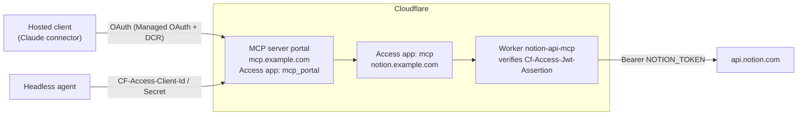

# notion-mcp-portal

A Notion API MCP server on Cloudflare Workers, protected by Cloudflare Access and served through a Cloudflare MCP server portal.

- **One URL** for every MCP client (`https://mcp.example.com/mcp`), with more servers addable behind it later.
- **People log in with SSO** through Access Managed OAuth, so Claude and other hosted clients connect as an ordinary custom connector.
- **Headless agents use a service token** and never need a browser.
- **The Notion token never leaves the Worker.** Clients and models never see it.
- **Runs on the Workers Free plan.** No Durable Objects, no sandbox.

I built this so my own agents (Claude, plus a self-hosted agent on a home server) could share one authenticated Notion connection instead of each holding an integration token. Everything here runs in production for me; this repo is the cleaned-up, reusable version.

## Architecture



There are three layers of auth, and each has one job:

| Layer | Decides | Configured in |
|---|---|---|
| Portal Access app (`mcp_portal`) | Who may use the portal at all (your email; a service token for agents) | Zero Trust → Access controls → Applications |
| Server Access app (`mcp`) | Who may reach the Worker's hostname; the portal authenticates to it once, as you | Zero Trust → Access controls → Applications |
| Worker JWT check | Rejects anything that didn't come through Access, even if a route is misconfigured | `ACCESS_AUD` in `wrangler.jsonc` |

## Tools

| Tool | What it does |
|---|---|
| `notion_find_endpoints` | Keyword search over the bundled Notion OpenAPI spec. Pass `operation_id` to get one endpoint's full parameter and body schema, with `$ref`s resolved. |
| `notion_request` | Calls any Notion API endpoint (`method`, `path`, `query`, `body`). Sets the right `Notion-Version` per endpoint, retries 429s, and returns Notion's error code and message so the model can self-correct. |

Two generic tools cover the whole API, so the tool list stays small. The model looks an endpoint up, then calls it.

## Security model

- **Fail closed.** If `ACCESS_TEAM_DOMAIN` or `ACCESS_AUD` is unset, or the `Cf-Access-Jwt-Assertion` doesn't verify against your team's JWKS (issuer and audience), the Worker returns 401. Only `/health` is open.
- **No bypass URLs.** `workers_dev` and `preview_urls` are off, so the Worker is reachable only on the hostname Access protects.
- **Requests are pinned to Notion.** Paths must start with `/v1/` and must resolve to `api.notion.com`.
- **Least privilege lives in Notion.** The integration sees only pages you share with it. Share the minimum.
- **Redirect allowlists stay explicit.** Managed OAuth's Dynamic Client Registration only accepts listed callback URLs. Never allow all: the allowlist is what stops a stranger's client from receiving your tokens.

One limitation: every portal user acts as the same Notion integration (a workspace bot), not as their own Notion account. This is fine for one person and their agents. It is not multi-tenant.

## Setup

See **[docs/SETUP.md](docs/SETUP.md)**. In short:

1. Create a Notion internal integration and share pages with it.
2. Deploy the Worker and set the `NOTION_TOKEN` secret.
3. Protect its hostname with an Access app (type MCP) using Managed OAuth, then set `ACCESS_AUD` and redeploy.
4. Register it as an MCP server in Zero Trust and authenticate it.
5. Add it to an MCP server portal and allowlist your clients' callbacks.
6. Connect Claude (or anything else) to `https://mcp.example.com/mcp`.
7. Optional: give headless agents a service token.

Things break in specific, non-obvious ways along the way. **[docs/TROUBLESHOOTING.md](docs/TROUBLESHOOTING.md)** lists every one I hit, with the fix.

## Local development

```bash
npm ci
npm run check   # type-check + wrangler dry-run build
npm run dev     # local server on test/dev-entry.ts with a fake token
```

`test/dev-entry.ts` skips the Access check so you can exercise the MCP handler locally. Never deploy it.

`npm run dev` needs the `workerd` binary. If your npm version blocks install scripts, approve `workerd`'s postinstall when npm asks.

## Lessons learned

The code was the easy part. Almost all the debugging was Access configuration:

1. **Managed OAuth needs redirect allowlists on both apps.** The server app must allow the dashboard's server OAuth callback and the portal's `/servers-callback`. The portal app must allow each client's callback. When a list is empty, the failure looks like "authentication required" forever, or "Couldn't register with … sign-in service".
2. **Access policy rules are OR'd.** A login-method rule ("Google", "One-time PIN") next to an email rule lets in *anyone* who can use that login method. Login methods belong on the app's identity providers; the policy should say *who*.
3. **Service tokens and per-user OAuth don't mix.** A service token can't complete a per-user OAuth grant, so the portal leaves out servers that require one. Turn the server's *Require user auth* off in the portal for agent access.
4. **Agents must not try OAuth.** An agent with an OAuth block in its MCP config attempts Dynamic Client Registration and gets `400 invalid_client_metadata: redirect_uri is not allowed`. Send the two service-token headers instead, with no OAuth config.
5. **Scripted clients can trip Browser Integrity Check** (error 1010). Exempt only `/mcp` and the OAuth discovery paths, not the whole host.
6. **Add the server to the portal only after it shows Ready.** A save made earlier didn't persist for me.

## License

MIT. `src/notion-openapi.json` comes from [makenotion/notion-mcp-server](https://github.com/makenotion/notion-mcp-server) (MIT); see [THIRD_PARTY_NOTICES.md](THIRD_PARTY_NOTICES.md).
