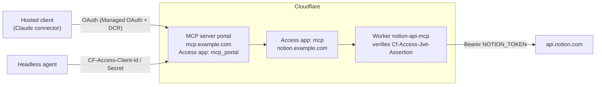

# notion-mcp-portal

A Notion API MCP server on Cloudflare Workers, protected by Cloudflare Access and served through a Cloudflare MCP server portal.

- **One URL** for every MCP client (`https://mcp.example.com/mcp`), with more servers addable behind it later.
- **People log in with SSO** through Access Managed OAuth, so Claude, ChatGPT and other hosted clients connect as an ordinary custom connector.
- **Headless agents use a service token** and never need a browser.
- **The Notion token never leaves the Worker.** Clients and models never see it.
- **Runs on the Workers Free plan.** No Durable Objects, no sandbox.

I built this for two reasons. First, so all my agents (Claude and ChatGPT on the web, plus a self-hosted agent on a home server) could share one authenticated Notion connection instead of each holding an integration token. Second, for a second rate-limit budget: Notion limits each connection separately, so bulk and scheduled jobs can run here without using up the official connector's budget. Everything here runs in production for me; this repo is the cleaned-up, reusable version.

## Why not just use Notion's official MCP connector?

The official hosted connector is easy to set up and does things this can't (see below). This project makes different trade-offs:

| | Official hosted Notion MCP | notion-mcp-portal |
|---|---|---|
| **What the AI can reach** | Everything your Notion account can see (OAuth as you) | Only the pages you share with the integration |
| **Headless agents** | Per-user OAuth in a browser | Service token: two headers, no browser |
| **Tool footprint in context** | 67 tools, 74,841 tokens of definitions in my connector (measured Oct 2026) | 2 tools, 1,226 tokens |
| **Plan gating** | Some tools and search filters need Business/Enterprise or a "full version" | The public REST API; workspace limits such as file-upload size still apply |
| **Model steering** | Upsells built in: its server instructions tell your assistant to suggest saving work in Notion and to link Notion's upgrade card when a tool needs a higher plan | No server instructions. Tool text only says how to call the API |
| **Rate limits** | Notion's API limits apply to every tool call: 180 requests/min per connection (600 on Business/Enterprise) plus a workspace-wide cap. Retries once if the wait is 2 s or less; otherwise returns `rate_limited`. Plans below Business with Notion AI also get a usage allowance for SQL queries | The same Notion API limits, on the integration's own budget, separate from the official connector's (both count toward the workspace cap). All your clients share that budget. Retries 429s up to twice, honoring `Retry-After` (capped at 10 s). The Workers Free plan adds a cap of 100,000 requests/day |
| **Who changes it** | Notion can change tools and instructions at any time | You pin dependency versions and decide when to deploy |
| **Audit trail** | Notion's | Cloudflare Access logs every connection, plus Worker logs |
| **Where the Notion credential lives** | An OAuth grant held by each client | One integration token, only inside the Worker; clients hold a revocable Cloudflare grant |

### Measured

Token counts from the Anthropic token-counting API (`claude-opus-5-5`), measured on my workspace on 2026-10-30 with [`npm run bench`](bench/README.md). Your pages will differ.

| What the model reads | Tokens |
|---|---|
| Tool definitions: official connector (67 tools) | 74,841 |
| Tool definitions: notion-mcp-portal (2 tools) | 1,226 |

| Tool result | Raw Notion JSON | Compact (default) | Saved |
|---|---|---|---|
| Retrieve a page | 1,033 | 581 | 44% |
| Query a data source (10 rows) | 10,177 | 5,870 | 42% |
| Block children (one level) | 3,313 | 2,424 | 27% |
| Search (10 results) | over the 24,000-character cap, truncated | 8,491 | fits whole |
| Page as Markdown (whole page) | 4,038 | 4,007 | 1% |

**Use the official connector instead** if you need features the public API doesn't expose: Notion AI search across connected apps, meeting-note transcripts, Notion Calendar, Notion's memory and agent sessions. Also choose it if a team needs per-person Notion permissions, or if you just want zero setup.

## Architecture



There are three layers of auth, and each has one job:

| Layer | Decides | Configured in |
|---|---|---|
| Portal Access app (`mcp_portal`) | Who may use the portal at all (your email; a service token for agents) | Zero Trust → Access controls → Applications |
| Server Access app (`mcp`) | Who may reach the Worker's hostname; the portal authenticates to it once, as you | Zero Trust → Access controls → Applications |
| Worker JWT check | Rejects anything that didn't come through Access, even if a route is misconfigured | `ACCESS_AUD` in `wrangler.jsonc` |

## Tools

| Tool | What it does |
|---|---|
| `notion_find_endpoints` | Keyword search over the bundled Notion OpenAPI spec (top 8 matches). Pass `operation_id` to get one endpoint's full parameter and body schema, with `$ref`s resolved. |
| `notion_request` | Calls any Notion API endpoint (`method`, `path`, `query`, `body`). Returns compact results by default: nulls, property and option ids, and rich-text formatting are dropped (`format: "raw"` returns Notion's full JSON). Sets the right `Notion-Version` per endpoint, retries 429s, and returns Notion's error code and message so the model can self-correct. |

Two generic tools cover the whole API, so the tool list stays small. The model looks an endpoint up, then calls it.

## Security model

- **Fail closed.** If `ACCESS_TEAM_DOMAIN` or `ACCESS_AUD` is unset, or the `Cf-Access-Jwt-Assertion` doesn't verify against your team's JWKS (issuer and audience), the Worker returns 401. Only `/health` is open.
- **No bypass URLs.** `workers_dev` and `preview_urls` are off, so the Worker is reachable only on the hostname Access protects.
- **Requests are pinned to Notion.** Paths must start with `/v1/` and must resolve to `api.notion.com`.
- **Least privilege lives in Notion.** The integration sees only pages you share with it. Share the minimum.
- **Redirect allowlists stay explicit.** Managed OAuth's Dynamic Client Registration only accepts listed callback URLs. Never allow all: the allowlist is what stops a stranger's client from receiving your tokens.

One limitation: every portal user acts as the same Notion integration (a workspace bot), not as their own Notion account. This is fine for one person and their agents. It is not multi-tenant.

## Setup

See **[docs/SETUP.md](docs/SETUP.md)**. In short:

1. Create a Notion internal integration and share pages with it.
2. Deploy the Worker and set the `NOTION_TOKEN` secret.
3. Protect its hostname with an Access app (type MCP) using Managed OAuth, then set `ACCESS_AUD` and redeploy.
4. Register it as an MCP server in Zero Trust and authenticate it.
5. Add it to an MCP server portal and allowlist your clients' callbacks.
6. Connect Claude (or anything else) to `https://mcp.example.com/mcp`.
7. Optional: give headless agents a service token.

Things break in specific, non-obvious ways along the way. **[docs/TROUBLESHOOTING.md](docs/TROUBLESHOOTING.md)** lists every one I hit, with the fix.

## Local development

```bash
npm ci
cp wrangler.example.jsonc wrangler.jsonc   # your config; gitignored
npm run check   # type-check + wrangler dry-run build
npm run dev     # local server on test/dev-entry.ts with a fake token
```

`test/dev-entry.ts` skips the Access check so you can exercise the MCP handler locally. Never deploy it.

`npm run dev` needs the `workerd` binary. If your npm version blocks install scripts, approve `workerd`'s postinstall when npm asks.

## License

MIT. `src/notion-openapi.json` comes from [makenotion/notion-mcp-server](https://github.com/makenotion/notion-mcp-server) (MIT); see [THIRD_PARTY_NOTICES.md](THIRD_PARTY_NOTICES.md).
